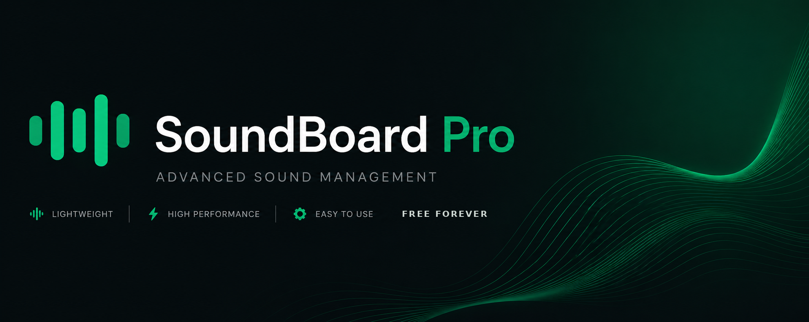
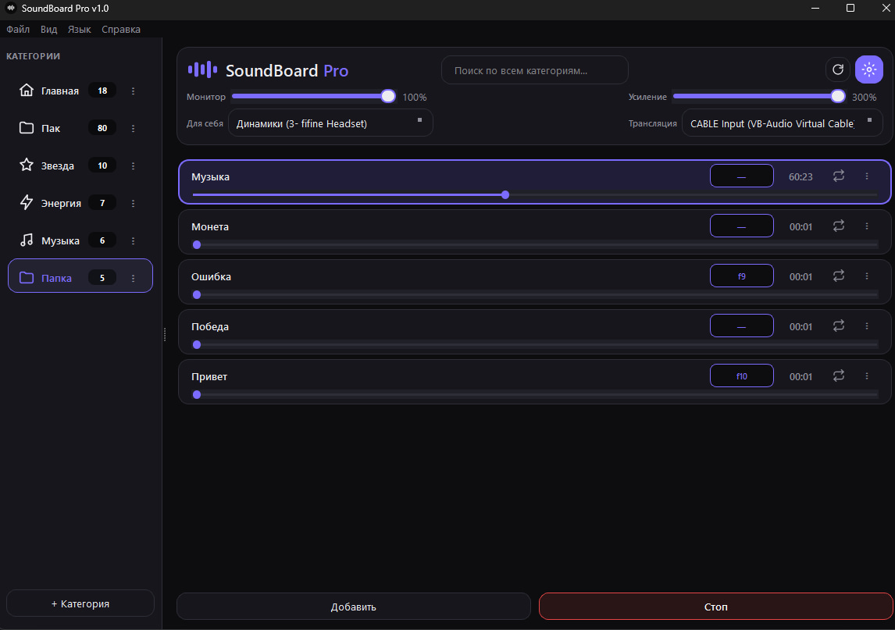
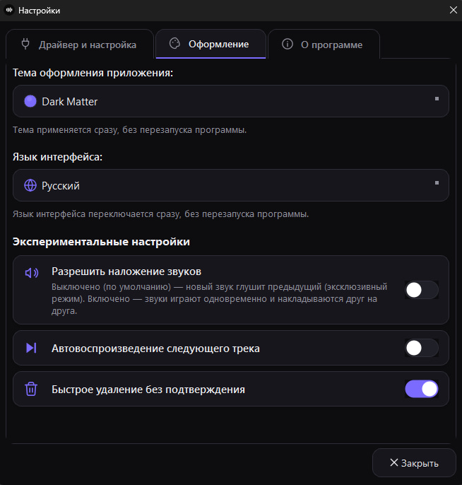
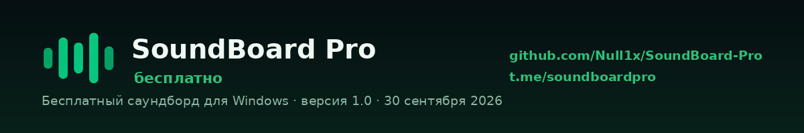

 

# 🔊 SoundBoard Pro

**Бесплатный саундборд для Windows 10 / 11**

Звук из хоткея прямо в микрофон. Discord, OBS, игровые голосовые чаты — делись звуками так же легко, как собственным голосом.

  
  
  
  

[🇷🇺 Русский](#-русский) · [🇬🇧 English](#-english)

[📥 Скачать](https://github.com/Null1x/SoundBoard-Pro/releases/latest) · [📢 Telegram](https://t.me/soundboardpro) · [🌐 Сайт](https://null1x.github.io/SoundBoard-Pro/)

---

# 🎃 SoundBoard Pro 1.1 — Happy Halloween!

<b>✨ Что нового в версии 1.1</b>

### 🎃 Halloween Theme

Встречайте праздничную тему оформления!

- Чёрно-фиолетовая палитра с оранжевыми акцентами.
- Анимированный фон с черепами, пауками, летучими мышами и искрами.
- Шестерёнка настроек заменена интерактивной тыквой, которая загорается при наведении.
- Отдельное оформление диалоговых окон.

### ⚡ Новые возможности

- **Отмена удаления (Ctrl+Z):** восстановление до 20 последних операций удаления, включая массовое удаление.
- **Плавная остановка:** звук теперь затухает при нажатии «Стоп» и Panic.
- **Автонастройка аудиоустройств:** автоматический подбор подходящих устройств для воспроизведения и трансляции.
- **Мастер настройки аудио:** пошаговая проверка VB-CABLE, наушников и микрофона.
- **Установка VB-CABLE:** скачивание официального установщика и запуск установки прямо из приложения.
- **Адаптация интерфейса:** цвет выделения элементов автоматически подстраивается под выбранную тему.

### 🛠️ Исправления и оптимизация

- Исправлены зависания настроек и проблемы при изменении размеров окон.
- Улучшено определение и выбор аудиоустройств.
- Исправлены сбои автовоспроизведения.
- Устранены конфликты при быстром переключении воспроизведения.
- Повышена надёжность библиотеки и сохранности звуков.
- Исправлены проблемы при одновременном воспроизведении нескольких звуков.
- Оптимизированы ресемплинг, использование оперативной памяти и нагрузка на процессор.
- Улучшена локализация и работа интерфейса на русском и английском языках.

---

# 🇷🇺 Русский

## 📥 Скачать SoundBoard Pro

**Windows 10 / 11 · x64 · Бесплатно**

Последняя версия: [GitHub Releases](https://github.com/Null1x/SoundBoard-Pro/releases/latest)

## 💡 Что такое SoundBoard Pro?

SoundBoard Pro — бесплатный саундборд для Windows, созданный на Python и PyQt6.

Программа позволяет воспроизводить звуки с помощью глобальных горячих клавиш и передавать их через виртуальный аудиокабель прямо в микрофон.

Твои звуки смогут услышать собеседники в Discord, зрители на трансляциях OBS и другие игроки в голосовом чате.

Проект создан как бесплатная альтернатива Soundpad — без платной подписки и лишней сложности.

## ⚡ Основные возможности

| | Возможность | Описание |
|---|---|---|
| ⚡ | **Быстрое воспроизведение** | Запуск звуков практически мгновенно |
| ⌨️ | **Глобальные хоткеи** | Работают даже тогда, когда открыта игра или другое приложение |
| 🎧 | **Двойная маршрутизация** | Одновременное воспроизведение в наушники и виртуальный кабель |
| ◉ | **Автоопределение VB-CABLE** | Поиск виртуального аудиоустройства |
| ✦ | **Наложение звуков** | Несколько звуков могут воспроизводиться одновременно |
| 🎨 | **Темы оформления** | Несколько цветовых тем, включая Halloween |
| 🔍 | **Поиск** | Быстрый поиск по библиотеке |
| 🗂️ | **Категории** | Организация звуков по папкам, отдельная громкость и усиление |

## 🖼️ Скриншоты

| Главное окно | Настройки |
|:---:|:---:|
|  |  |
| Библиотека звуков и управление воспроизведением | Настройка программы и оформление |

## 🚀 Установка

**1. Скачай программу**

Перейди в раздел [последних релизов](https://github.com/Null1x/SoundBoard-Pro/releases/latest) и скачай установщик `SoundBoardPro-Setup-1.1.exe`.

**2. Установи VB-CABLE**

Для передачи звука в микрофон необходим бесплатный виртуальный аудиокабель VB-CABLE.

В SoundBoard Pro 1.1 появилась возможность скачать установщик прямо из приложения. Также его можно получить вручную на [официальном сайте VB-Audio](https://vb-audio.com/Cable/).

При установке драйвера потребуется подтверждение прав администратора. После установки рекомендуется перезагрузить компьютер.

**3. Настрой микрофон**

Нажми `Win + R`, введи `mmsys.cpl` и нажми Enter.

1. Открой вкладку **Запись**.
2. Выбери свой настоящий микрофон и открой его свойства.
3. Перейди во вкладку **Прослушать**.
4. Включи «Прослушивать с данного устройства».
5. В качестве устройства воспроизведения выбери `CABLE Input (VB-Audio Virtual Cable)`.
6. Нажми «Применить».

Теперь в виртуальный кабель будет передаваться и твой голос, и звуки из SoundBoard Pro.

**4. Настрой SoundBoard Pro**

Запусти программу и воспользуйся автонастройкой или мастером настройки аудио.

Если автоматическое определение не сработало, укажи устройства вручную:

- **Для себя:** твои наушники или колонки.
- **Для трансляции:** `CABLE Input (VB-Audio Virtual Cable)`.

**5. Выбери виртуальный микрофон**

В приложении, куда нужно передавать звук, установи `CABLE Output (VB-Audio Virtual Cable)` в качестве устройства ввода.

| Приложение | Где настроить |
|---|---|
| **Discord** | Настройки → Голос и видео → Устройство ввода |
| **OBS** | Источник → Захват входного аудиопотока |
| **Игры** | Настройки голосового чата → Микрофон |

**6. Настрой Discord**

Если звуки слышны слишком тихо или обрываются, проверь настройки шумоподавления.

Открой «Голос и видео» и при необходимости отключи:

- Эхоподавление.
- Шумоподавление (Krisp).
- Автоматическую регулировку усиления.

Discord может воспринимать звуки саундборда как фоновый шум.

## ❓ Частые вопросы

<b>Windows пишет «Windows защитила ваш компьютер»</b>

Это предупреждение SmartScreen. Установщик пока не имеет цифровой подписи.

Если ты скачал программу из официального репозитория, можешь проверить файл через [VirusTotal](https://www.virustotal.com/).

<b>Программа не видит VB-CABLE</b>

Убедись, что драйвер установлен с правами администратора и компьютер был перезагружен после установки.

Затем воспользуйся кнопкой обновления списка аудиоустройств.

<b>Собеседник слышит звуки, но не слышит мой голос</b>

Проверь настройку микрофона из третьего шага установки. Убедись, что настоящий микрофон передаёт звук в `CABLE Input`.

<b>Звуки слишком тихие или обрываются</b>

Проверь настройки шумоподавления Discord. Иногда они могут блокировать звуки, передаваемые через виртуальный кабель.

<b>В игре не работают горячие клавиши</b>

Проверь, не занята ли комбинация самой игрой.

Если игра запущена с правами администратора, Windows может ограничивать взаимодействие с обычным приложением. В таком случае может потребоваться запуск SoundBoard Pro с аналогичными правами.

<b>Антивирус обнаруживает угрозу в установщике</b>

Некоторые антивирусы могут ошибочно реагировать на приложения, собранные через PyInstaller.

Проверь файл на [VirusTotal](https://www.virustotal.com/) и убедись, что скачал его из официального репозитория.

<b>Какие системные требования?</b>

- Windows 10 или Windows 11.
- Архитектура x64.
- VB-CABLE для передачи звука в микрофон.

## 💬 Обратная связь

SoundBoard Pro развивается благодаря отзывам пользователей.

Если ты обнаружил ошибку, хочешь предложить новую функцию или просто поделиться впечатлениями — буду рад обратной связи!

- 📧 **Почта:** [limora342@gmail.com](mailto:limora342@gmail.com)
- 📢 **Telegram:** [@soundboardpro](https://t.me/soundboardpro)
- 🐛 **Сообщить об ошибке:** [GitHub Issues](https://github.com/Null1x/SoundBoard-Pro/issues)

При сообщении об ошибке желательно указать версию Windows, версию программы, описание проблемы и приложить скриншот.

## ❤️ Поддержать разработку

SoundBoard Pro бесплатен и таким останется.

Если программа оказалась тебе полезна, ты можешь поддержать её дальнейшую разработку:

- ⭐ Поставить звезду репозиторию на GitHub.
- 💜 [Поддержать проект через DonationAlerts](https://www.donationalerts.com/r/nullix).
- 📢 Рассказать о программе друзьям.

Любая поддержка помогает развивать проект и выпускать новые обновления!

---

# 🇬🇧 English

## 📥 Download SoundBoard Pro

**Windows 10 / 11 · x64 · Free**

Get the latest version: [GitHub Releases](https://github.com/Null1x/SoundBoard-Pro/releases/latest)

## 💡 What is SoundBoard Pro?

SoundBoard Pro is a free soundboard for Windows, built with Python and PyQt6.

Play sounds using global hotkeys and route them directly into your microphone through a virtual audio cable.

Your friends on Discord, viewers on OBS and teammates in in-game voice chats can hear your sounds just like your voice.

A free alternative to Soundpad, without paid subscriptions.

## ⚡ Features

| | Feature | Description |
|---|---|---|
| ⚡ | **Fast playback** | Sounds start almost instantly |
| ⌨️ | **Global hotkeys** | Work while playing games or using other applications |
| 🎧 | **Dual audio routing** | Play sounds through your headphones and virtual cable simultaneously |
| ◉ | **VB-CABLE detection** | Automatically detect the virtual audio device |
| ✦ | **Sound overlay** | Multiple sounds can play simultaneously |
| 🎨 | **Themes** | Multiple color themes, including Halloween |
| 🔍 | **Search** | Quickly find sounds in your library |
| 🗂️ | **Categories** | Organize sounds into folders with individual volume and gain settings |

## 🖼️ Screenshots

| Main window | Settings |
|:---:|:---:|
|  |  |
| Sound library and playback controls | Application settings and customization |

## 🚀 Installation

**1. Download the application**

Go to [GitHub Releases](https://github.com/Null1x/SoundBoard-Pro/releases/latest) and download `SoundBoardPro-Setup-1.1.exe`.

**2. Install VB-CABLE**

A free virtual audio cable is required to route sound into your microphone.

SoundBoard Pro 1.1 can download the installer directly from the application. Alternatively, get it from the [official VB-Audio website](https://vb-audio.com/Cable/).

Administrator permission is required to install the driver. Restart your computer after installation.

**3. Route your microphone**

Press `Win + R`, type `mmsys.cpl` and hit Enter.

1. Open the **Recording** tab.
2. Select your real microphone and open its properties.
3. Go to the **Listen** tab.
4. Enable **Listen to this device**.
5. Select `CABLE Input (VB-Audio Virtual Cable)` as the playback device.
6. Click Apply.

Your microphone and SoundBoard Pro audio will now be routed through the virtual cable.

**4. Configure SoundBoard Pro**

Launch the application and use automatic audio setup or the audio setup wizard.

If automatic detection fails, select the devices manually:

- **Monitor output:** your headphones or speakers.
- **Broadcast output:** `CABLE Input (VB-Audio Virtual Cable)`.

**5. Select your virtual microphone**

Set `CABLE Output (VB-Audio Virtual Cable)` as your input device in the application where you want to transmit audio.

| Application | Settings |
|---|---|
| **Discord** | Settings → Voice & Video → Input Device |
| **OBS** | Add an Audio Input Capture source |
| **Games** | Voice Chat Settings → Microphone |

**6. Configure Discord**

If sounds are too quiet or get cut off, check Discord's noise suppression settings.

Open Voice & Video and, if necessary, disable:

- Echo Cancellation.
- Noise Suppression (Krisp).
- Automatic Gain Control.

Discord may mistake soundboard audio for background noise.

## ❓ FAQ

<b>Windows SmartScreen warns me about the installer</b>

This is a SmartScreen warning. The installer is currently unsigned.

If you downloaded it from the official repository, you can scan it using [VirusTotal](https://www.virustotal.com/).

<b>VB-CABLE is not detected</b>

Make sure the driver was installed with administrator permissions and restart your computer.

Then refresh the audio device list in SoundBoard Pro.

<b>People hear sounds but cannot hear my voice</b>

Check the microphone configuration in step 3. Make sure your real microphone is routed into `CABLE Input`.

<b>Sounds are too quiet or keep cutting out</b>

Check Discord's noise suppression settings. They may block sounds routed through the virtual cable.

<b>Hotkeys don't work in games</b>

Make sure the key combination isn't already used by the game.

If the game runs as administrator, Windows may restrict interaction with a regular application. You may need to run SoundBoard Pro with the same permissions.

<b>My antivirus detects the installer</b>

Some antivirus programs may incorrectly flag applications built with PyInstaller.

Scan the file using [VirusTotal](https://www.virustotal.com/) and make sure you downloaded it from the official repository.

<b>System requirements</b>

- Windows 10 or Windows 11.
- x64 architecture.
- VB-CABLE for microphone audio routing.

## 💬 Feedback

SoundBoard Pro grows with user feedback.

Found a bug, have an idea for a new feature or just want to share your experience? I'd love to hear from you!

- 📧 **Email:** [limora342@gmail.com](mailto:limora342@gmail.com)
- 📢 **Telegram:** [@soundboardpro](https://t.me/soundboardpro)
- 🐛 **Bug reports:** [GitHub Issues](https://github.com/Null1x/SoundBoard-Pro/issues)

When reporting a bug, please include your Windows version, application version, a description of the issue and a screenshot if possible.

## ❤️ Support development

SoundBoard Pro is free and will stay free.

If you find the application useful, you can support its development:

- ⭐ Star the repository on GitHub.
- 💜 [Support the project via DonationAlerts](https://www.donationalerts.com/r/nullix).
- 📢 Share the application with your friends.

Every bit of support helps keep the project growing!

---

### 🔊 SoundBoard Pro

**Made with ❤️ by [Nullix](https://github.com/Null1x)**

[📥 Download](https://github.com/Null1x/SoundBoard-Pro/releases/latest) · [📢 Telegram](https://t.me/soundboardpro) · [🌐 Website](https://null1x.github.io/SoundBoard-Pro/) · [▶️ YouTube](https://www.youtube.com/@NullixYT)

Free soundboard for Windows 10 / 11

