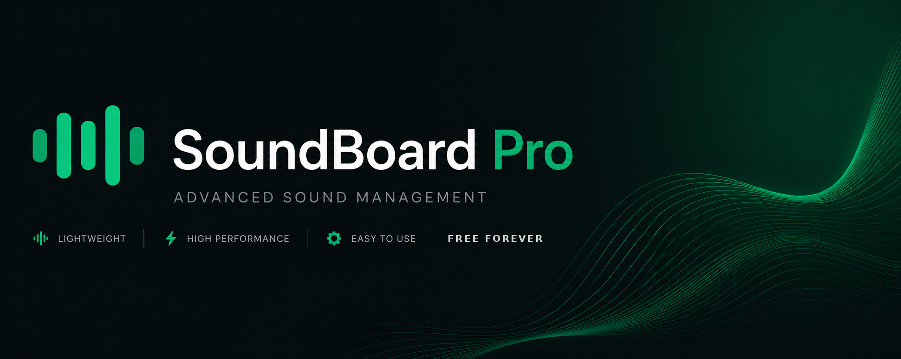
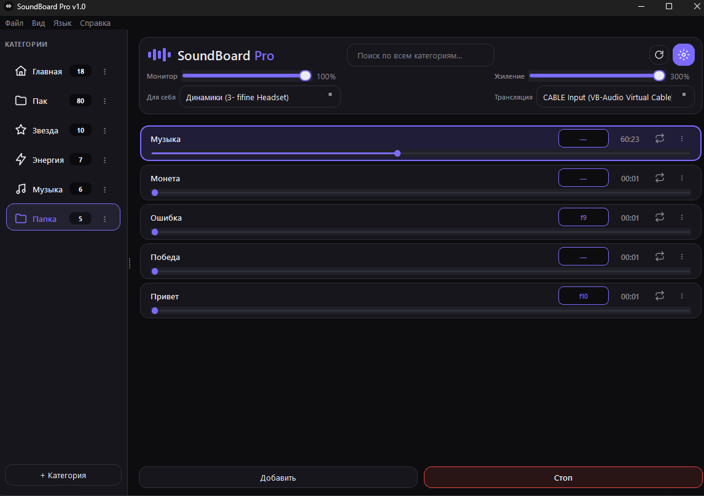
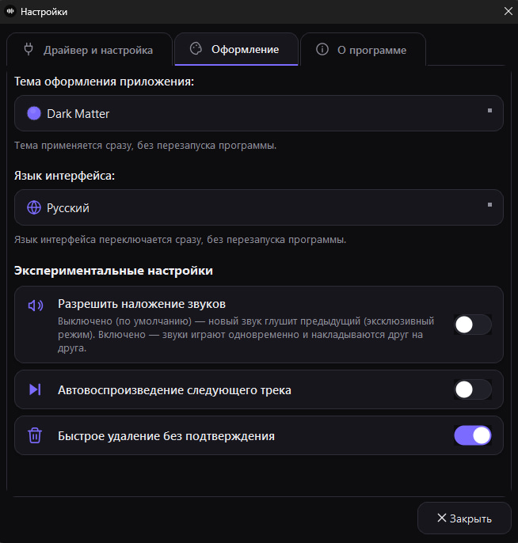
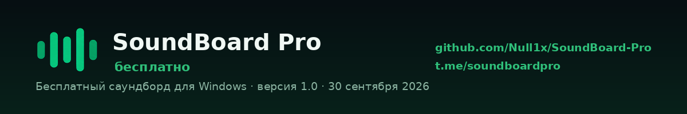

# 🔊 SoundBoard Pro

**Бесплатный саундборд для Windows.** Звук из хоткея уходит прямо в микрофон — собеседники в Discord, зрители в OBS и игроки в голосовом чате слышат его так же, как твой голос.

[🇷🇺 Русский](#-русский) · [🇬🇧 English](#-english) · [📢 Telegram](https://t.me/soundboardpro) · [🌐 Сайт](https://null1x.github.io/SoundBoard-Pro/)

---

## 🇷🇺 Русский

> ### ⬇️ [Скачать SoundBoard Pro 1.0](https://github.com/Null1x/SoundBoard-Pro/releases/latest)
> Windows 10 / 11 · бесплатно · установка 5 минут (нужен бесплатный виртуальный кабель VB-CABLE)

### Что это

SoundBoard Pro — саундборд для Windows на PyQt6. Нажимаешь хоткей — звук уходит в микрофон: Discord, OBS, голосовой чат в игре. Никаких подписок, никаких прав администратора, никакого запуска «от имени администратора», чтобы хоткеи работали в игре.

Сделано как бесплатная замена Soundpad: те же задачи, без оплаты.

### Возможности

| | Возможность | Что даёт |
|---|---|---|
| ⚡ | **Нулевая задержка** | Воспроизведение через `sounddevice` — звук стартует мгновенно |
| ⌨ | **Глобальные хоткеи** | Работают из игр и других приложений, права администратора не нужны |
| 🎧 | **Двойная маршрутизация** | Звук идёт одновременно в наушники и в виртуальный кабель: слышишь сам и слышат другие |
| ◉ | **Виртуальный кабель** | Автопоиск VB-Audio при запуске — руками ничего настраивать не надо |
| ✦ | **Наложение звуков** | Несколько звуков играют одновременно и накладываются друг на друга |
| 🎨 | **8 тем оформления** | Тема и язык переключаются на ходу, без перезапуска программы |
| 🔍 | **Поиск по звукам** | Мгновенный поиск по всем категориям |
| 🗂 | **Категории** | Библиотека по папкам, отдельная громкость и усиление для каждой |

### Скриншоты

| Главное окно | Настройки |
|---|---|
|  |  |
| Категории, устройства и воспроизведение | Тема, язык, экспериментальные функции |

### Установка (5 минут)

**1. Скачай установщик**

Возьми `SoundBoardPro-Setup-1.0.exe` из [последнего релиза](https://github.com/Null1x/SoundBoard-Pro/releases/latest) и запусти его.

**2. Поставь VB-CABLE** — бесплатный виртуальный аудиокабель, без него звук не попадёт в микрофон

1. Скачай с [vb-audio.com/Cable](https://vb-audio.com/Cable/)
2. Распакуй архив и запусти `VBCABLE_Setup_x64.exe` **от имени администратора**
3. Перезагрузи компьютер

**3. Заведи свой микрофон в кабель**

Нажми `Win + R`, впиши `mmsys.cpl`, Enter — откроется окно «Звук».

1. Вкладка **Запись** → выбери **свой настоящий микрофон** (не CABLE) → **Свойства**
2. Вкладка **Прослушать** → поставь галочку **«Прослушивать с данного устройства»**
3. В списке ниже, **«Воспроизводить с данного устройства»**, выбери **CABLE Input (VB-Audio Virtual Cable)**
4. **Применить** → **ОК**

Теперь в кабель идёт и твой голос, и звуки из SoundBoard Pro. Без этого шага собеседник услышит только звуки — голоса не будет.

**4. Запусти SoundBoard Pro**

Программа сама найдёт кабель. Если не нашла — выбери в поле трансляции **CABLE Input (VB-Audio Virtual Cable)**, а в поле «Для себя» свои наушники или колонки, чтобы слышать звуки самому.

**5. Поставь `CABLE Output` микрофоном там, куда транслируешь**

| Куда | Что нажать |
|---|---|
| **Discord** | Настройки → Голос и видео → Устройство ввода → `CABLE Output (VB-Audio Virtual Cable)` |
| **OBS** | Источник «Захват входного аудиопотока» → устройство `CABLE Output` |
| **Игра** | В настройках голосового чата выбери микрофоном `CABLE Output` |

**6. В Discord выключи шумодав**

Настройки → Голос и видео → выключи **«Эхоподавление»**, **«Шумоподавление»** (Krisp) и **«Автоматическая регулировка усиления»**. Discord считает звуки из саундборда фоновым шумом и режет их. Если звуки слышно тихо или они обрываются — проверяй это первым делом.

### Частые вопросы

<b>Windows пишет «Windows защитила ваш компьютер»</b>

Это SmartScreen. Он срабатывает на любом неподписанном `.exe`, а сертификат подписи стоит денег — установщик пока не подписан. Нажми «Подробнее» → «Выполнить в любом случае». Проверить файл можно на [VirusTotal](https://www.virustotal.com/).

<b>Программа не видит VB-Cable</b>

Убедись, что кабель установлен именно от имени администратора и что компьютер перезагружен после установки. Затем нажми в программе кнопку обновления списка устройств.

<b>Собеседник слышит звуки, но не слышит меня</b>

Пропущен шаг 3 — микрофон не заведён в кабель. `Win + R` → `mmsys.cpl` → вкладка **Запись** → свой микрофон → **Свойства** → вкладка **Прослушать** → поставь галочку **«Прослушивать с данного устройства»** и выбери в списке `CABLE Input (VB-Audio Virtual Cable)`.

<b>Звуки слышно тихо или они обрываются</b>

Это шумодав Discord. Настройки → Голос и видео → выключи «Эхоподавление», «Шумоподавление» (Krisp) и «Автоматическая регулировка усиления».

<b>В игре не работают хоткеи</b>

Проверь, что хоткей не занят самой игрой. Если игра запущена от администратора, запусти от администратора и SoundBoard Pro.

<b>Антивирус ругается на установщик</b>

Ложное срабатывание: сборки PyInstaller часто попадают в эвристику антивирусов. Файл можно проверить на [VirusTotal](https://www.virustotal.com/).

<b>Требования</b>

Windows 10 или 11 (x64). Больше ничего не нужно.

### Обратная связь

**Напиши, что не работает.** Проект делает один человек, и любой отзыв — это буквально то, из-за чего выходят обновления.

📧 **Почта для багов, жалоб и идей:** [limora342@gmail.com](mailto:limora342@gmail.com)
📢 **Новости и обновления:** [t.me/soundboardpro](https://t.me/soundboardpro)

Что полезно указать: версия Windows и версия программы, что делал, что ожидал, что получилось вместо этого, скриншот или короткое видео, если можно.

### Поддержать проект

SoundBoard Pro был бесплатным и останется бесплатным. Если он тебе пригодился — [поддержи разработку](https://www.donationalerts.com/r/nullix) или просто поставь ⭐ этому репозиторию: звёзды помогают другим людям его найти.

## 🇬🇧 English

> ### ⬇️ [Download SoundBoard Pro 1.0](https://github.com/Null1x/SoundBoard-Pro/releases/latest)
> Windows 10 / 11 · free · 5-minute setup (requires the free VB-CABLE virtual audio cable)

### What it is

SoundBoard Pro is a soundboard for Windows built with PyQt6. Hit a hotkey — the sound goes into your microphone, so people on Discord, your OBS viewers or players in game voice chat hear it exactly like your voice. No subscription, no admin rights, no "run as administrator" just to make hotkeys work in a game.

Built as a free replacement for Soundpad: same job, no payment.

### Features

| | Feature | What it does |
|---|---|---|
| ⚡ | **Zero latency** | Playback through `sounddevice` — sounds start instantly |
| ⌨ | **Global hotkeys** | Work from inside games and other apps, no administrator needed |
| 🎧 | **Dual routing** | The sound goes to your headphones *and* to the virtual cable at the same time |
| ◉ | **Virtual cable** | VB-Audio is detected automatically on startup |
| ✦ | **Sound overlay** | Several sounds can play and layer at the same time |
| 🎨 | **8 themes** | Theme and language switch instantly, no restart |
| 🔍 | **Instant search** | Search across every category |
| 🗂 | **Categories** | Organise your library, per-category volume and gain |

### Install

**1. Download the installer** — `SoundBoardPro-Setup-1.0.exe` from the [latest release](https://github.com/Null1x/SoundBoard-Pro/releases/latest).

**2. Install VB-CABLE** — free virtual audio cable: [vb-audio.com/Cable](https://vb-audio.com/Cable/). Run `VBCABLE_Setup_x64.exe` **as administrator**, then reboot.

**3. Route your own microphone into the cable**

Press `Win + R`, type `mmsys.cpl`, hit Enter.

1. **Recording** tab → select **your real microphone** (not CABLE) → **Properties**
2. **Listen** tab → tick **"Listen to this device"**
3. Under **"Playback through this device"** pick **CABLE Input (VB-Audio Virtual Cable)**
4. **Apply** → **OK**

Now the cable carries both your voice and the sounds from SoundBoard Pro. Skip this step and people will hear the sounds but not you.

**4. Launch SoundBoard Pro** — it finds the cable and sets it as the broadcasting output automatically. If it doesn't, pick **CABLE Input (VB-Audio Virtual Cable)** as the broadcasting device and your headphones as the monitor device.

**5. Select `CABLE Output (VB-Audio Virtual Cable)` as the input device** in Discord (Voice & Video → Input Device), OBS (Audio Input Capture) or your game's voice chat settings.

**6. Turn off Discord's noise suppression** — Settings → Voice & Video → disable **Echo Cancellation**, **Noise Suppression** (Krisp) and **Automatic Gain Control**. Discord treats soundboard audio as background noise and cuts it. If sounds come through too quiet or get chopped up, check this first.

### FAQ

<b>Windows SmartScreen warns me about the installer</b>

It flags any unsigned `.exe`, and code signing certificates cost money — the build isn't signed yet. Click "More info" → "Run anyway". You can scan the file on [VirusTotal](https://www.virustotal.com/).

<b>VB-Cable isn't detected</b>

Make sure it was installed as administrator and that you rebooted afterwards. Then hit the device refresh button in the app.

<b>People hear the sounds but not my voice</b>

Step 3 is missing — your microphone isn't routed into the cable. `Win + R` → `mmsys.cpl` → **Recording** tab → your microphone → **Properties** → **Listen** tab → tick **"Listen to this device"** and select `CABLE Input (VB-Audio Virtual Cable)`.

<b>Sounds are too quiet or keep cutting out</b>

That's Discord's noise suppression. Settings → Voice & Video → disable Echo Cancellation, Noise Suppression (Krisp) and Automatic Gain Control.

<b>Requirements</b>

Windows 10 or 11 (x64). Nothing else.

### Feedback

**Tell me what's broken.** This is a one-person project — every report is literally what decides the next update.

📧 **Bugs, complaints and ideas:** [limora342@gmail.com](mailto:limora342@gmail.com)
📢 **News and updates:** [t.me/soundboardpro](https://t.me/soundboardpro)

Useful details: your Windows and app version, what you did, what you expected, what happened instead, plus a screenshot if you can.

### Support

SoundBoard Pro is free and stays free. If it's useful to you, [support development](https://www.donationalerts.com/r/nullix) or just ⭐ this repo — stars are how other people find it.

<b>SoundBoard Pro</b> · <a href="https://github.com/Null1x/SoundBoard-Pro/releases/latest">Скачать</a> · <a href="https://t.me/soundboardpro">Telegram</a> · <a href="https://null1x.github.io/SoundBoard-Pro/">Сайт</a> · <a href="https://www.youtube.com/@NullixYT">YouTube</a> · <a href="mailto:limora342@gmail.com">limora342@gmail.com</a> 
Сделано <a href="https://github.com/Null1x">Nullix</a>

